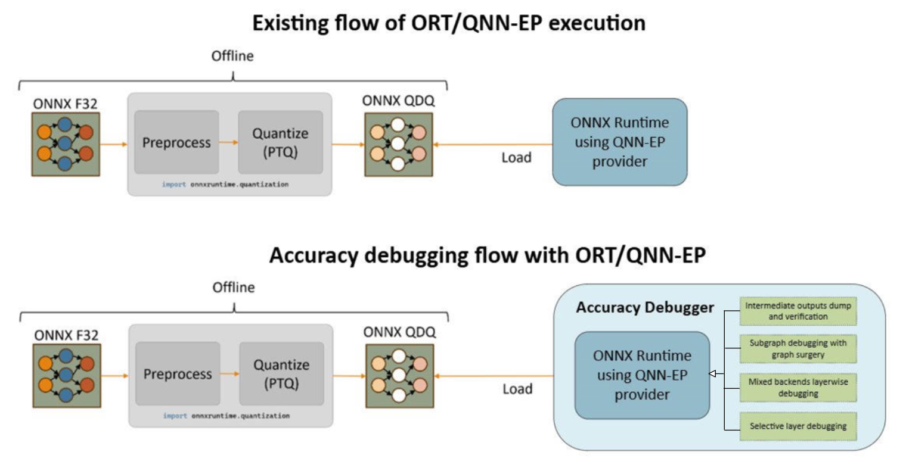
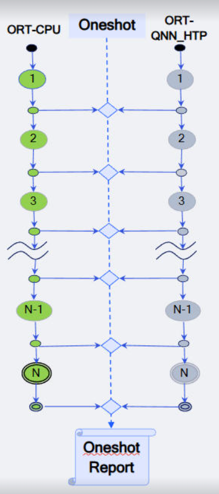
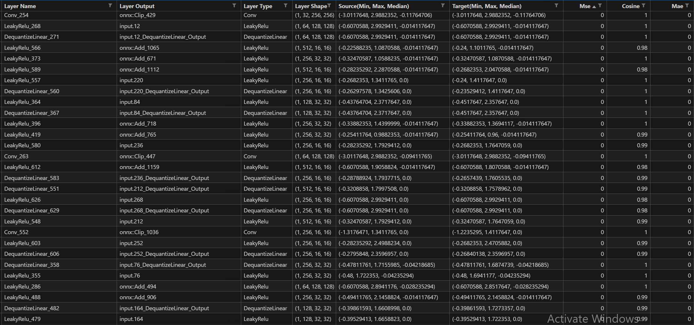
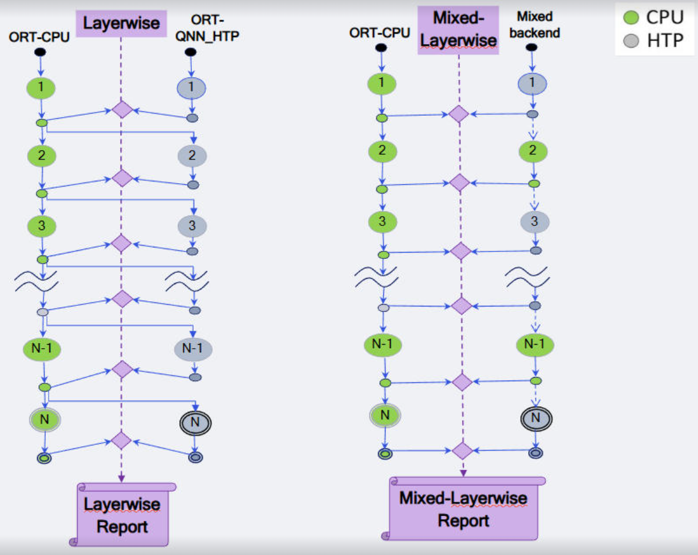
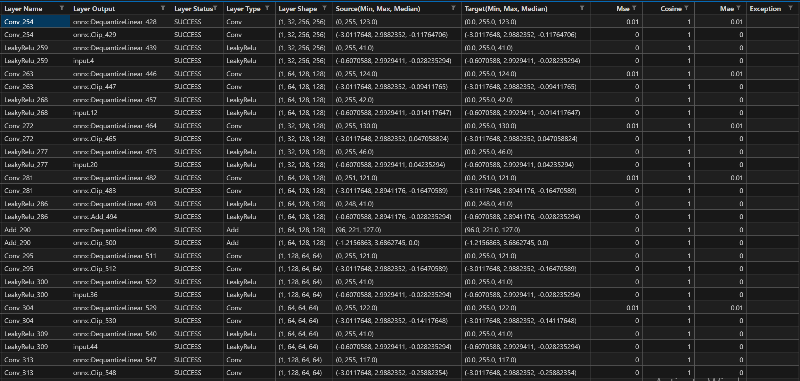

# Accuracy Debugger for ONNX Runtime QNN EP

The Accuracy debugger tool finds accuracy issues in quantized (QDQ) ONNX models that run on QNN EP. It runs the model
on QNN EP with the HTP backend (the **target**) and on the ONNX Runtime (ORT) CPU Execution Provider (the
**reference**), and compares their intermediate layer outputs.



## Contents

- [Features](#features)
- [Setup](#setup)
- [Usage](#usage)
- [Limitations](#limitations)
- [Oneshot snooping](#oneshot-snooping)
- [Layerwise snooping](#layerwise-snooping)
- [Framework op tracing](#framework-op-tracing)
- [Elementwise statistics](#elementwise-statistics)
- [JSON reports](#json-reports)
- [Further reading](#further-reading)

## Features

The debugger finds inaccuracies in a model at the layer level. These features are available:

1. **Oneshot snooping** runs the whole model once and compares the outputs of all its layers.
2. **Layerwise snooping** runs each layer on its own, with reference inputs, to find the layers that cause the
   error. **Mixed layerwise snooping** runs the layers you choose on the ORT CPU EP and the rest on QNN HTP.
3. **Elementwise statistics** list the elements that differ by more than a given number of steps. Both
   algorithms support them.
4. **Framework op tracing** adds the compiled QNN op, its fusion and the reason for any CPU fallback to each
   report row, and keeps QNN HTP fusions intact while the model is debugged.

Both algorithms can debug a subset of the layers, chosen by name or op type, and score each tensor with one or
more [comparators](#comparators). The reference is one of:

| Reference | Option |
|---|---|
| The QDQ model on the ORT CPU EP | Default |
| Another FP32 or QDQ model on the ORT CPU EP | `--reference_model` (oneshot only) |
| Tensors computed earlier, as `.raw` files | `--golden_reference` (see [Golden reference](#golden-reference)) |

## Setup

1. Install `onnxruntime` and `onnxruntime-qnn` as described in
   [Install](https://github.com/onnxruntime/onnxruntime-qnn#install). The target runs on QNN HTP, so run the
   debugger on a device with a Qualcomm NPU, such as a Windows on Snapdragon PC.
2. Install the other packages listed in [requirements.txt](requirements.txt):

   ```bash
   pip install onnx==1.23.2 numpy==2.5.4 pandas==3.1.0 pydantic==2.14.1 matplotlib==3.11.2
   ```

   These are the versions that the debugger was validated with, on Python 3.14.

The debugger is a standalone script and needs no installation. Run it from this directory, or pass the full
path of `accuracy_debugger.py`.

## Usage

```bat
python accuracy_debugger.py --qdq_model QDQ_MODEL --input_list INPUT_LIST [options]
```

### Arguments

| Argument | Default | Description |
|---|---|---|
| `--qdq_model` | Required | QDQ ONNX model to debug. |
| `--input_list` | Required | Text file that lists the input files of the model (see [Input list](#input-list)). |
| `--algorithm` | `oneshot` | `oneshot` or `layerwise`. |
| `--reference_model` | The QDQ model | FP32 or QDQ ONNX model to run on the ORT CPU EP as the reference. Oneshot only. |
| `--golden_reference` | None | Directory of reference `.raw` files to use instead of a reference run (see [Golden reference](#golden-reference)). |
| `--comparator` | `mse` | One or more [comparators](#comparators), separated by spaces, for example `--comparator mse cosine`. Repeated names are ignored. |
| `--set_intermediate_layers` | All layers | Comma-separated layer names or op types to debug, for example `conv1,Gemm,MatMul`. |
| `--set_cpu_layers` | None | Layerwise only. Comma-separated layer names or op types to run on the ORT CPU EP instead of QNN HTP (mixed layerwise snooping). |
| `--dump_elementwise_stats` | None | `"<layer name or op type>=<steps>;..."`. Logs each element whose difference is larger than `steps` (see [Elementwise statistics](#elementwise-statistics)). Needs a QDQ reference. |
| `--enable_framework_op_trace` | Off | Generates a QNN framework op trace for every target compilation (see [Framework op tracing](#framework-op-tracing)). |
| `--dump_qnn_ep_input_graph` | Off | Also dumps the graph that QNN EP receives, next to each trace. Requires `--enable_framework_op_trace`. |
| `--op_trace_file` | None | Existing QNN framework op trace to use, optionally merged with `original_sources` by the op trace matcher. |
| `--working_directory` | `./working_directory` | Base directory for the outputs. A directory that you pass must already exist. |
| `--output_directory` | Start time, `YYYY-MM-DD_HH-MM-SS` | Name of the run directory (see [Output directory](#output-directory)). `""` writes the outputs directly into `<working directory>/<algorithm>_snooping/`. |
| `--log_level` | `INFO` | `ERROR`, `WARN`, `INFO`, `DEBUG` or `VERBOSE` (the same as `DEBUG`), in any case. |

Only the first sample of the input list is debugged. A run that uses `--reference_model` with layerwise,
`--set_cpu_layers` with oneshot, or `--dump_elementwise_stats` with an FP32 reference fails with an error.

<details>
<summary>Full <code>--help</code> output</summary>

```text
usage: python accuracy_debugger.py [-h] --qdq_model QDQ_MODEL --input_list INPUT_LIST [--op_trace_file OP_TRACE_FILE]
                                   [--enable_framework_op_trace] [--dump_qnn_ep_input_graph]
                                   [--reference_model REFERENCE_MODEL] [--algorithm {oneshot,layerwise}]
                                   [--comparator {l1_norm,l2_norm,average,cosine,standard_deviation,mse,snr,kl_divergence,rtol_atol,l1_error,mse_rel,topk,adjusted_rtol_atol,mae} [{l1_norm,l2_norm,average,cosine,standard_deviation,mse,snr,kl_divergence,rtol_atol,l1_error,mse_rel,topk,adjusted_rtol_atol,mae} ...]]
                                   [--working_directory WORKING_DIRECTORY] [--output_directory OUTPUT_DIRECTORY]
                                   [--golden_reference GOLDEN_REFERENCE]
                                   [--set_intermediate_layers SET_INTERMEDIATE_LAYERS]
                                   [--set_cpu_layers SET_CPU_LAYERS] [--dump_elementwise_stats DUMP_ELEMENTWISE_STATS]
                                   [--log_level {ERROR,WARN,INFO,DEBUG,VERBOSE}]

options:
  -h, --help            show this help message and exit

Required arguments:
  --qdq_model QDQ_MODEL
                        Path to QDQ ONNX model.
  --input_list INPUT_LIST
                        Path to text file containing input list.

Optional arguments:
  --op_trace_file OP_TRACE_FILE
                        QNN framework op trace JSON, optionally enriched with original_sources.
  --enable_framework_op_trace
                        Generate a QNN framework op trace for every target compilation, under the output directory.
  --dump_qnn_ep_input_graph
                        Also dump the EP input graph next to each trace for offline name recovery (requires
                        --enable_framework_op_trace).
  --reference_model REFERENCE_MODEL
                        Path to reference ONNX model. If not provided, given qdq_model will be run on ORT-CPU to
                        generate reference outputs. Note: This argument is allowed only with oneshot algorithm (for
                        layerwise algorithm qdq_model itself will be used to generate ORT-CPU reference outputs).
  --algorithm {oneshot,layerwise}
                        Algorithm to use to debug the model.
  --comparator {l1_norm,l2_norm,average,cosine,standard_deviation,mse,snr,kl_divergence,rtol_atol,l1_error,mse_rel,topk,adjusted_rtol_atol,mae} [{l1_norm,l2_norm,average,cosine,standard_deviation,mse,snr,kl_divergence,rtol_atol,l1_error,mse_rel,topk,adjusted_rtol_atol,mae} ...]
                        Comparator to use to compare tensors. For multiple comparators, specify as follows:
                        --comparator mse cosine
  --working_directory WORKING_DIRECTORY
                        Path to working directory. If not specified, a directory with name working_directory will be
                        created in the current directory.
  --output_directory OUTPUT_DIRECTORY
                        Name of the output directory. If not specified, a directory with name <timestamp> will be
                        created in the working directory.
  --golden_reference GOLDEN_REFERENCE
                        The path of directory where golden reference tensor files are saved.
  --set_intermediate_layers SET_INTERMEDIATE_LAYERS
                        Pass comma separated layer names/types which needs to be debugged. Can specify layer names
                        like conv1_output, fc_layer_output or layer types like Conv, Gemm, MatMul. e.g.,
                        --set_intermediate_layers conv1_output,Gemm,MatMul,fc_layer_output
  --set_cpu_layers SET_CPU_LAYERS
                        Pass comma separated layer names/types which needs to be executed on CPU Execution-Provider.
                        This option is supported only with layerwise algorithm. Can specify layer names like
                        conv1_output, fc_layer_output or layer types like Conv, Gemm, MatMul. e.g., --set_cpu_layers
                        conv1_output,Gemm,MatMul,fc_layer_output
  --dump_elementwise_stats DUMP_ELEMENTWISE_STATS
                        Dumps elementwise comparison statistics for the specified layer names/types along with their
                        corresponding allowed step value. Can specify layer names like conv1_output, fc_layer_output
                        or layer types like Conv, MatMul. Step value has to be an integer which represents allowed
                        steps while comparing elementwise. e.g., --dump_elementwise_stats
                        'conv1_output=3;Gemm=1;MatMul=2;fc_layer_output=5'
  --log_level {ERROR,WARN,INFO,DEBUG,VERBOSE}
                        Enable verbose logging.
```

</details>

### Exit codes

| Code | Meaning |
|---|---|
| `0` | Success. |
| `2` | Invalid arguments: a missing model, input list or trace file, a malformed `--dump_elementwise_stats` value, `--dump_qnn_ep_input_graph` without `--enable_framework_op_trace`, or an unknown option. |
| `1` | Any other error. The run log, `accuracy_debugger_user_info.log`, has the traceback. An error that occurs before the run directory exists, such as a missing `--working_directory`, is printed as `error: ...`. |

> [!IMPORTANT]
> Run one debugger at a time on a device when you compare scores between runs. When runs share the QNN HTP, a
> few layers can score worse, with more elements one quantization step off (up to 77 times the MSE on a
> ResNet-50 layer). A run that has the HTP to itself gives the same scores every time.

### Input list

The input list is a text file with one sample per line. Each line gives the input files of the model, separated
by spaces:

```text
# <input name>:=<path>
t.1:=dog.raw
```

A model with two inputs:

```text
input_ids:=data/input_ids.raw attention_mask:=data/attention_mask.raw
```

- Write each file as `<input name>:=<path>`, or give bare paths, which are matched to the model inputs in order.
- Relative paths are resolved against the directory of the input list.
- Each file holds the raw binary data of one input, in the input's data type (for example float32). It is
  reshaped to the input's shape.
- Quote a path that contains spaces, for example `input:="C:\model data\sample.raw"`. Backslashes are kept as
  they are.
- Only the first sample is used. If the list has more, a warning says so.

### Golden reference

`--golden_reference` uses reference tensors computed earlier, instead of running a reference model:

- Every `*.raw` file in the directory and its subdirectories is loaded, except the files in `target_outputs`
  and `subgraph_data` directories. If the directory has `batch_*` subdirectories, only `batch_1` is loaded.
- Each file holds float32 values. Its name, without `.raw`, is the tensor name. The values are cast to the tensor's data type and reshaped to its shape.
- The `reference_outputs` directory of an earlier run works as it is.

### Output directory

Each run writes its outputs to `<working directory>/<algorithm>_snooping/<output directory>/`:

- `<working directory>` is `--working_directory`, or `working_directory` in the current directory.
- `<algorithm>_snooping` is `oneshot_snooping` or `layerwise_snooping`.
- `<output directory>` is `--output_directory`, or the start time of the run, as `YYYY-MM-DD_HH-MM-SS`.

Tensor files and layer directories are named after their tensor or layer. Every character outside
`[A-Za-z0-9_]` becomes `_`, and a `_` is added at the start unless the name starts with a letter or `_`. For
example, `49_QuantizeLinear_Output` is stored as `_49_QuantizeLinear_Output.raw`, and the layer
`layer2.0.downsample.0` gets the directory `layer2_0_downsample_0`.

The contents of the run directory are described in [Oneshot output](#oneshot-output) and
[Layerwise output](#layerwise-output).

### Comparators

Each comparator scores the target tensor T against the reference tensor R. Before scoring, both tensors are
flattened and rounded to 5 decimal places, except for `rtol_atol`.

| Comparator | Score | Best value |
|---|---|---|
| `l1_norm` | Relative L1 norm of the error: ‖T − R‖₁ / ‖R‖₁ | 0 |
| `l2_norm` | Relative L2 norm of the error: ‖T − R‖₂ / ‖R‖₂ | 0 |
| `average` | Mean absolute error, relative to the larger mean magnitude: mean\|R − T\| / max(mean\|R\|, mean\|T\|) | 0 |
| `cosine` | Cosine similarity of R and T; 0 if either is all zeros | 1 |
| `standard_deviation` | Relative difference of the standard deviations: \|std(T) − std(R)\| / \|std(R)\| | 0 |
| `mse` (default) | Mean squared error: mean((R − T)²); 100 if R is all zeros and T is not | 0 |
| `snr` | Signal-to-noise ratio in dB: 10 log₁₀(mean(R²) / mean((R − T)²)); 100 for identical tensors | Higher is better |
| `kl_divergence` | Kullback-Leibler divergence (base 2) of the L2-normalized tensors. Tensors with negative values usually give `inf` or `NaN`. | 0 |
| `rtol_atol` | Percentage of elements that are not close, by `numpy.isclose` with rtol 0.01 and atol 0.01 (see the warning below) | 0 |
| `l1_error` | Sum of absolute errors: Σ\|R − T\| | 0 |
| `mse_rel` | Relative mean squared error: mean((R − T)²) / mean(R²) | 0 |
| `topk` | Percentage of the target's top-k indices that are not among the reference's top-k indices, with k = 1 | 0 |
| `adjusted_rtol_atol` | Percentage of elements that are not close, with rtol 0.1 and an atol of four 8-bit quantization steps of the reference range, 4 (max(R) − min(R)) / 255 | 0 |
| `mae` | Mean absolute error: mean\|R − T\| | 0 |

> [!WARNING]
> `rtol_atol` divides by the length of the tensor's first dimension instead of by its number of elements, as the
> legacy tool did. Its scores are only correct when the first dimension holds all the elements, as in a 1-D
> tensor. For an activation such as `(1, 64, 56, 56)` they are wrong, and usually negative. Use
> `adjusted_rtol_atol` for such tensors.

## Limitations

1. Models with dynamic input shapes are not supported, because QNN EP does not support them. The debugger has
   no option to set symbolic dimensions.
2. Layerwise snooping checks each extracted subgraph with the ONNX checker, so it needs a model that passes the
   checker. A layer whose subgraph fails the check gets a `SKIP` row.
3. QNN EP supports a subset of the ONNX operators; see
   [Supported ONNX operators](../../../docs/execution_providers/QNN-ExecutionProvider.md#supported-onnx-operators).
   ORT runs the other nodes on its CPU EP.
4. EPContext models, whose compiled QNN graph is cached in `com.microsoft::EPContext` nodes, are not supported.
   Debug the original QDQ ONNX model.
5. Exposing intermediate tensors and extracting layers can stop QNN EP from fusing ops. Use a trace option to
   keep QNN EP's fusions intact (see [Fusion protection](#fusion-protection)).

## Oneshot snooping

Oneshot snooping debugs all layers of the model in one run:

1. Runs the reference model (FP32 or QDQ) on the ORT CPU EP and dumps its intermediate outputs.
2. Runs the QDQ model on ORT QNN EP (HTP) and dumps its intermediate outputs.
3. Compares the target outputs (step 2) with the reference outputs (step 1).
4. Supports selective analysis by layer name or op type (`--set_intermediate_layers`).
5. Supports elementwise statistics (`--dump_elementwise_stats`).

Use oneshot snooping for a quick check of which layers of the model are sensitive to quantization. Errors
accumulate along the graph, as they do when the model is deployed.



The compared tensors are the outputs of the activation Q/DQ nodes:

- With a QDQ reference, each layer gets a row for its QuantizeLinear output, with quantized values, and a row
  for its DequantizeLinear output, with float values.
- With an FP32 reference, only DequantizeLinear outputs are compared. Each one is matched to the FP32 tensor
  with the same name or [file name form](#output-directory), or else to an FP32 tensor whose name is the start
  of the DQ output name, followed by `_`, `/`, `.` or `:`. With trace options, the trace is tried first (see
  [Framework op tracing](#framework-op-tracing)).
- Weight and bias Q/DQ outputs are not compared.

### Oneshot sample commands

Basic command:

```bat
python accuracy_debugger.py ^
    --algorithm oneshot ^
    --qdq_model r50_w8a8.qdq.onnx ^
    --input_list input_list.txt
```

With an FP32 reference model:

```bat
python accuracy_debugger.py ^
    --algorithm oneshot ^
    --qdq_model mv2_w8a8.qdq.onnx ^
    --reference_model mobilenet-v2.onnx ^
    --input_list input_list.txt
```

With reference outputs computed earlier (golden reference):

```bat
python accuracy_debugger.py ^
    --algorithm oneshot ^
    --qdq_model r50_w8a8.qdq.onnx ^
    --input_list input_list.txt ^
    --golden_reference .\goldens\r50\reference_outputs
```

Debugging only all `Add` layers and two named layers:

```bat
python accuracy_debugger.py ^
    --algorithm oneshot ^
    --qdq_model r50_w8a8.qdq.onnx ^
    --input_list input_list.txt ^
    --set_intermediate_layers Add,layer1.2.conv3,layer4.2.conv1
```

Dumping elementwise statistics:

```bat
python accuracy_debugger.py ^
    --algorithm oneshot ^
    --qdq_model r50_w8a8.qdq.onnx ^
    --input_list input_list.txt ^
    --dump_elementwise_stats "layer1.2.conv3=0;layer4.2.conv1=1"
```

With debug logs and several comparators:

```bat
python accuracy_debugger.py ^
    --algorithm oneshot ^
    --qdq_model r50_w8a8.qdq.onnx ^
    --input_list input_list.txt ^
    --log_level debug ^
    --comparator mse cosine mae average
```

For commands with framework op tracing, see [Framework op tracing](#framework-op-tracing).

> [!TIP]
> The samples are written for the Windows Command Prompt, where `^` continues a command on the next line. In
> PowerShell, end the lines with a backtick (`` ` ``) instead, and in bash with `\`.

### Oneshot output

```text
working_directory
└── oneshot_snooping
    └── 2026-11-04_10-15-30
        ├── plots
        ├── reference_outputs
        ├── target_outputs
        ├── accuracy_debugger_user_info.log
        ├── elementwise_stats.log
        ├── oneshot.csv
        └── oneshot.json
```

| Output | Contents |
|---|---|
| `plots` | One line plot per comparator, `<comparator>.png`, of the scores of all compared tensors. Written when matplotlib is installed. |
| `reference_outputs` | Intermediate outputs of the reference, one float32 `.raw` file per tensor, and `profile_info.json` with the data type, shape, minimum, maximum and median of each tensor. Not written with `--golden_reference`. |
| `target_outputs` | Intermediate outputs of the target, one float32 `.raw` file per tensor. |
| `accuracy_debugger_user_info.log` | Run log. |
| `elementwise_stats.log` | Elementwise statistics. Written with `--dump_elementwise_stats`, when an element differs by more than the allowed steps. |
| `oneshot.csv` | Report, with one row per compared tensor. |
| `oneshot.json` | The same report as JSON (see [JSON reports](#json-reports)). |

With trace options, the run directory also has a `fusion_probe` directory and, with
`--enable_framework_op_trace`, an `op_trace` directory (see [Trace files](#trace-files)).

### Oneshot report

Example of `oneshot.csv`, opened in a spreadsheet:



| Column | Description |
|---|---|
| Layer Name | ONNX node whose output the Q/DQ nodes quantize. The rows of a Q/DQ chain on a model input are named after their own Q or DQ node, for example `t.1_QuantizeLinear`. |
| Layer Output | Compared tensor, a QuantizeLinear or DequantizeLinear output. |
| Layer Type | Op type of the layer, for example `Conv`. |
| Layer Shape | Shape of the tensor. |
| Source(Min, Max, Median) | Minimum, maximum and median of the reference tensor. |
| Target(Min, Max, Median) | Minimum, maximum and median of the target tensor. |
| `<comparator>` | One column per comparator, with the score of the target tensor against the reference tensor. |

With trace options, five more columns follow `Target(Min, Max, Median)` (see [Report columns](#report-columns)).

## Layerwise snooping

Layerwise snooping debugs one layer at a time:

1. Runs the QDQ model on the ORT CPU EP and dumps its intermediate outputs.
2. Extracts each layer of the model as a subgraph and runs it on ORT QNN EP (HTP), with reference outputs as
   its inputs.
3. Compares the outputs of each subgraph (step 2) with the reference outputs (step 1).
4. Supports selective analysis by layer name or op type (`--set_intermediate_layers`).
5. Supports elementwise statistics (`--dump_elementwise_stats`).
6. Supports mixed layerwise snooping, where the layers chosen with `--set_cpu_layers` run on the ORT CPU EP and
   the rest on QNN HTP.

Layerwise snooping gives a deeper analysis. Each layer gets reference inputs, so its rows show only the error
that the layer itself adds. This finds all the layers that cause accuracy deviation on the hardware.



How the layers are formed and run:

- A layer is an ONNX node and the Q/DQ nodes that follow it, on every output branch. Its rows are the outputs
  of those Q/DQ nodes. Q, DQ, Transpose, Identity and Constant nodes are not debugged as layers, and neither are
  nodes without Q/DQ outputs or whose only Q/DQ outputs are weights and biases.
- Each subgraph runs in a new worker process, so no state carries over from one layer to the next.
- On QNN HTP, a subgraph keeps the model's static weights, and its inputs are quantized again with the model's
  quantization parameters. QNN HTP therefore compiles each layer as it does in the full model.
- With `--set_cpu_layers`, each subgraph takes its inputs from the target outputs of the earlier subgraphs,
  wherever they ran, and from the reference only for the other tensors.
- With trace options, each QNN HTP fusion is extracted as one subgraph (see [Fusion protection](#fusion-protection)).

### Layerwise sample commands

Basic command:

```bat
python accuracy_debugger.py ^
    --algorithm layerwise ^
    --qdq_model r50_w8a8.qdq.onnx ^
    --input_list input_list.txt
```

With reference outputs computed earlier (golden reference):

```bat
python accuracy_debugger.py ^
    --algorithm layerwise ^
    --qdq_model r50_w8a8.qdq.onnx ^
    --input_list input_list.txt ^
    --golden_reference .\goldens\r50\reference_outputs
```

Debugging only all `Add` layers and two named layers:

```bat
python accuracy_debugger.py ^
    --algorithm layerwise ^
    --qdq_model r50_w8a8.qdq.onnx ^
    --input_list input_list.txt ^
    --set_intermediate_layers Add,layer1.2.conv3,layer4.2.conv1
```

Mixed layerwise snooping, with all `Add` layers and two named layers on the ORT CPU EP:

```bat
python accuracy_debugger.py ^
    --algorithm layerwise ^
    --qdq_model r50_w8a8.qdq.onnx ^
    --input_list input_list.txt ^
    --set_cpu_layers Add,layer1.2.conv3,layer4.2.conv1
```

Dumping elementwise statistics:

```bat
python accuracy_debugger.py ^
    --algorithm layerwise ^
    --qdq_model r50_w8a8.qdq.onnx ^
    --input_list input_list.txt ^
    --dump_elementwise_stats "layer1.2.conv3=0;layer4.2.conv1=1"
```

With debug logs and several comparators:

```bat
python accuracy_debugger.py ^
    --algorithm layerwise ^
    --qdq_model r50_w8a8.qdq.onnx ^
    --input_list input_list.txt ^
    --log_level debug ^
    --comparator mse cosine mae average
```

### Layerwise output

```text
working_directory
└── layerwise_snooping
    └── 2026-11-04_10-20-45
        ├── plots
        ├── reference_outputs
        ├── subgraph_data
        │   ├── layer1_2_conv3
        │   │   ├── extracted_model.onnx
        │   │   └── target_outputs
        │   └── ...
        ├── accuracy_debugger_user_info.log
        ├── elementwise_stats.log
        ├── layerwise.csv
        └── layerwise.json
```

| Output | Contents |
|---|---|
| `plots` | One line plot per comparator, `<comparator>.png`, of the scores of all compared tensors. Written when matplotlib is installed. |
| `reference_outputs` | Intermediate outputs of the reference, one float32 `.raw` file per tensor, and `profile_info.json` with the data type, shape, minimum, maximum and median of each tensor. Not written with `--golden_reference`. |
| `subgraph_data` | One directory per debugged layer, named after the layer, with the extracted subgraph, `extracted_model.onnx`, and its outputs on the target in `target_outputs`, as float32 `.raw` files. |
| `accuracy_debugger_user_info.log` | Run log. |
| `elementwise_stats.log` | Elementwise statistics. Written with `--dump_elementwise_stats`, when an element differs by more than the allowed steps. |
| `layerwise.csv` | Report, with one row per compared tensor. The rows of each layer are added as soon as the layer finishes. |
| `layerwise.json` | The same report as JSON (see [JSON reports](#json-reports)). |

### Layerwise report

Example of `layerwise.csv`, opened in a spreadsheet:



| Column | Description |
|---|---|
| Layer Name | ONNX node whose output the Q/DQ nodes quantize. |
| Layer Output | Compared tensor, a QuantizeLinear or DequantizeLinear output. |
| Layer Status | Whether the layer was debugged: `SUCCESS`, or one of the failures `SKIP` (the subgraph could not be extracted), `INFERENCE_FAILURE` (the subgraph failed to run) and `VERIFICATION_FAILURE` (its outputs could not be compared with the reference). |
| Layer Type | Op type of the layer, for example `Conv`. |
| Layer Shape | Shape of the tensor. |
| Source(Min, Max, Median) | Minimum, maximum and median of the reference tensor. |
| Target(Min, Max, Median) | Minimum, maximum and median of the target tensor. |
| `<comparator>` | One column per comparator, with the score of the target tensor against the reference tensor. |
| Exception | Reason for a failure. |

A failed layer gets one row. Its Layer Output is the last tensor of its subgraph, and its comparator columns are
`NaN`.

With trace options, five more columns follow `Target(Min, Max, Median)` (see [Report columns](#report-columns)).

## Framework op tracing

When QNN EP compiles a model, it can write a framework op trace: a JSON file that maps each compiled QNN op to
the ONNX nodes it was built from, names the fusions applied and gives the reason for each node left to the CPU
EP. For the format, see
[QNN EP Framework Op Tracing](../../../docs/execution_providers/QNN-ExecutionProvider.md#qnn-ep-framework-op-tracing).

With a trace, the debugger:

- adds the compiled QNN op, its fusion and any CPU fallback reason to each report row (see
  [Report columns](#report-columns));
- uses the trace to find the reference tensor of each compared tensor before it tries name matching, which
  matters with an FP32 `--reference_model`, whose tensor names can differ from those of the QDQ model;
- keeps QNN HTP fusions intact while it debugs the model (see [Fusion protection](#fusion-protection)).

| Option | Effect |
|---|---|
| `--enable_framework_op_trace` | Generates a trace for every target compilation, in a new `op_trace/run_*` directory. |
| `--dump_qnn_ep_input_graph` | Also dumps the graph that QNN EP receives next to each trace, as `<graph name>.<n>_qnn_ep_input_graph.json`. Requires `--enable_framework_op_trace`. |
| `--op_trace_file` | Uses an existing trace (schema version 2, single-SoC or multi-SoC), such as one merged by the [op trace matcher](#matching-renamed-nodes). It takes precedence over generated traces. |

Without trace options, the reports have no trace columns and fusions are not protected. If a trace cannot be
read, a warning says so and tensors are matched by name. A tensor that the trace matches to more than one
reference tensor is skipped, with a warning.

### Tracing sample commands

Oneshot with a generated trace:

```bat
python accuracy_debugger.py ^
    --algorithm oneshot ^
    --qdq_model r18.qdq.onnx ^
    --input_list input_list.txt ^
    --enable_framework_op_trace
```

Layerwise with generated traces and EP input graph dumps:

```bat
python accuracy_debugger.py ^
    --algorithm layerwise ^
    --qdq_model r18.qdq.onnx ^
    --input_list input_list.txt ^
    --enable_framework_op_trace ^
    --dump_qnn_ep_input_graph
```

Oneshot with an existing trace:

```bat
python accuracy_debugger.py ^
    --algorithm oneshot ^
    --qdq_model r18.qdq.onnx ^
    --input_list input_list.txt ^
    --op_trace_file qnn_op_trace.merged.json
```

### Report columns

With trace options, the reports have these extra columns:

| CSV column | JSON key | Description |
|---|---|---|
| `QNN_Op_Name` | `qnn_op_name` | Compiled QNN op that produces the tensor. |
| `QNN_Op_Type` | `qnn_op_type` | Type of that QNN op, for example `Conv2d`. |
| `Fusion_Pattern` | `fusion_pattern` | How QNN EP grouped the ONNX nodes into that op: `OrtNodeUnit` for a single node with its Q/DQ nodes, or the name of a QNN EP fusion, such as `GeluFusion`. |
| `Original_ONNX_Nodes` | `original_onnx_nodes` | ONNX nodes compiled into that op, separated by `;`. |
| `CPU_Fallback_Reason` | `cpu_fallback_reason` | Why the tensor was computed on ORT CPU instead of QNN HTP. Empty when QNN HTP computed it. |

Rows of a ResNet-18 oneshot report with `--enable_framework_op_trace`, without some columns:

| Layer Name | Layer Output | QNN_Op_Name | QNN_Op_Type | Fusion_Pattern | CPU_Fallback_Reason | mse |
|---|---|---|---|---|---|---|
| `t.1_QuantizeLinear` | `t.1_QuantizeLinear_Output` | | | | QNN EP is configured to not take Q nodes that consume a graph input. | 0.0 |
| `conv1` | `49_QuantizeLinear_Output` | `conv1_token_1` | `Conv2d` | `OrtNodeUnit` | | 0.019589794799685478 |
| `conv1` | `49_DequantizeLinear_Output` | `conv1_token_1` | `Conv2d` | `OrtNodeUnit` | Dequantized on ORT CPU from its captured Q output; QNN EP cannot return a Q output and its DQ output together. | 1.7346720824207296e-06 |

- By default (QNN EP option `offload_graph_io_quantization`), QNN EP leaves the quantization of the model inputs
  to the ORT CPU EP, so `t.1_QuantizeLinear` runs on CPU.
- The `Original_ONNX_Nodes` of `conv1` are
  `DequantizeLinear_token_208;conv1.weight_DequantizeLinear;conv1.bias_DequantizeLinear;conv1_token_1;49_QuantizeLinear`:
  QNN EP compiled the DQ nodes of the input, weight and bias, the Conv and its output Q into one `Conv2d`.
- QNN EP cannot return both a Q output and the DQ output that follows it. The debugger therefore computes such
  a DQ output on ORT CPU, from the Q output that QNN HTP returned. The values are the same as when QNN EP
  dequantizes a graph output itself.

### Fusion protection

Exposing an intermediate tensor, or cutting a layer out of the model, can stop QNN EP from fusing the ops
around it, so the debugged model would not compile as it does in deployment. With either trace option, the
debugger first compiles the unmodified QDQ model on QNN HTP, without running it, and reads the fusions from
that trace. Then:

- Oneshot compares the outputs of each fusion, not the tensors inside it. A `--set_intermediate_layers` layer
  inside a fusion selects the outputs of the fusion, with a warning that names them.
- Layerwise extracts each fusion as one subgraph, named after its last layer. Any of its layers, by name or op
  type, selects the whole fusion in `--set_intermediate_layers` and `--set_cpu_layers`.

### Matching renamed nodes (Optional)

ORT can rename and copy nodes before QNN EP compiles them, as `DequantizeLinear_token_208` above, so some
trace entries do not name nodes of your model. The [op trace matcher](../op_trace_matcher/README.md) maps
them back to your model and writes a merged trace with `original_sources`, which the debugger reads with
`--op_trace_file`:

1. Run the debugger with `--enable_framework_op_trace` and `--dump_qnn_ep_input_graph`.
2. In the `op_trace/run_*` directory of the run, take the EP input graph dump with the highest `<n>` for the
   graph, for example `torch-jit-export.1_qnn_ep_input_graph.json`: it is the graph that QNN EP compiled.
   Lower numbers are earlier passes, for example before ORT's layout transform (see the
   [matcher documentation](../op_trace_matcher/README.md#qnn-ep--qdq-direct-workflow)).
3. Run the matcher, which needs only `onnx` and `numpy`. `RUN_DIR` is the run directory and `run_ID` the
   trace directory:

   ```bat
   python ..\op_trace_matcher\source_to_optimized_matcher.py ^
       --source-model r18.qdq.onnx ^
       --optimized-model RUN_DIR\op_trace\run_ID\torch-jit-export.1_qnn_ep_input_graph.json ^
       --qnn-trace RUN_DIR\op_trace\run_ID\qnn_op_trace.json ^
       --output mapping.json ^
       --joined-output qnn_op_trace.merged.json
   ```

4. Run the debugger with `--op_trace_file qnn_op_trace.merged.json`.

The debugger does not run the matcher itself.

### Trace files

A oneshot run with `--enable_framework_op_trace` and `--dump_qnn_ep_input_graph` writes:

```text
RUN_DIR
├── fusion_probe
│   └── op_trace
│       └── run_ID
│           └── qnn_op_trace.json
└── op_trace
    └── run_ID
        ├── qnn_op_trace.json
        ├── torch-jit-export.0_qnn_ep_input_graph.json
        └── torch-jit-export.1_qnn_ep_input_graph.json
```

| Path | Contents |
|---|---|
| `fusion_probe/op_trace/run_ID` | Trace of the compilation of the unmodified model, used for fusion protection. Written with either trace option. |
| `op_trace/run_ID` | Oneshot: trace of the target compilation, with the EP input graph dumps when `--dump_qnn_ep_input_graph` is given. |
| `subgraph_data/<layer>/op_trace/run_ID` | Layerwise: the same, for the subgraph of each layer. Layers that run on CPU because of `--set_cpu_layers` have none. |

Each compilation writes to a new `run_ID` directory, so a trace of an earlier run or layer is never read by
mistake. With `--op_trace_file`, only `fusion_probe` is written. A generated trace describes the debug
compilation itself, while a supplied trace describes the compilation that produced it.

## Elementwise statistics

`--dump_elementwise_stats` compares the outputs of the listed layers element by element. Its value is a
`;`-separated list of `<layer name or op type>=<steps>`, where `steps` is an integer of at least 0:

```bat
--dump_elementwise_stats "layer1.2.conv3=0;layer4.2.conv1=1"
```

An element is logged when the absolute difference between the target and the reference is larger than `steps`.
On a QuantizeLinear output, the values are quantized levels, so `steps` counts quantization steps. On a
DequantizeLinear output, the values are floats, so `steps` is a float difference.

For each tensor with at least one such element, the debugger adds a block to `elementwise_stats.log` in the run
directory. From the oneshot ResNet-50 sample, for the QuantizeLinear output of `layer1.2.conv3`:

```text
Starting Elementwise comparison for 198_QuantizeLinear_Output
Difference=1.0 at index (0, 1, 15, 55), Steps allowed=0.0, Target value: 127.0, Reference value: 128
Difference=1.0 at index (0, 1, 31, 55), Steps allowed=0.0, Target value: 127.0, Reference value: 128
Difference=1.0 at index (0, 1, 37, 55), Steps allowed=0.0, Target value: 127.0, Reference value: 128
...
Total number of elements that are further than 0.0 steps: 176497
Maximum step difference: 12.0
```

Elementwise statistics need a QDQ reference, so they cannot be used with an FP32 `--reference_model`.

## JSON reports

`oneshot.json` and `layerwise.json` hold the same results as the CSV reports, with one entry in `layers` per
report row. Part of a oneshot report with `--enable_framework_op_trace`:

```json
{
    "header": {
        "header_version": {"major": 0, "minor": 1, "patch": 0},
        "artifact_type": "ONESHOT_SNOOPING_REPORT",
        "algorithm": "oneshot",
        "version": {"major": 0, "minor": 1, "patch": 0}
    },
    "layers": [
        {
            "layer_name": "conv1",
            "layer_output": "49_QuantizeLinear_Output",
            "layer_type": "Conv",
            "layer_shape": [1, 64, 112, 112],
            "source_min_max_median": [0, 255, 20.0],
            "target_min_max_median": [0.0, 255.0, 20.0],
            "qnn_op_name": "conv1_token_1",
            "qnn_op_type": "Conv2d",
            "fusion_pattern": "OrtNodeUnit",
            "original_onnx_nodes": "DequantizeLinear_token_208;conv1.weight_DequantizeLinear;conv1.bias_DequantizeLinear;conv1_token_1;49_QuantizeLinear",
            "cpu_fallback_reason": "",
            "comparators": {"mse": 0.0195897948, "cosine": 1.0000016689}
        }
    ]
}
```

- A layerwise report has `LAYERWISE_SNOOPING_REPORT` and `layerwise` in its header, and each layer also has
  `layer_status` and `exception`.
- Without trace options, the layers have no `qnn_op_name`, `qnn_op_type`, `fusion_pattern`,
  `original_onnx_nodes` or `cpu_fallback_reason`.
- `NaN` and infinite scores are written as the string `"NaN"`.

## Further reading

- [design.md](design.md): how the debugger works, how it differs from the legacy tool and how to run its
  tests.
- [Op trace matcher](../op_trace_matcher/README.md): recovers the original node names of a framework op trace.
- [QNN Execution Provider](../../../docs/execution_providers/QNN-ExecutionProvider.md): QNN EP options,
  supported operators and framework op tracing.
